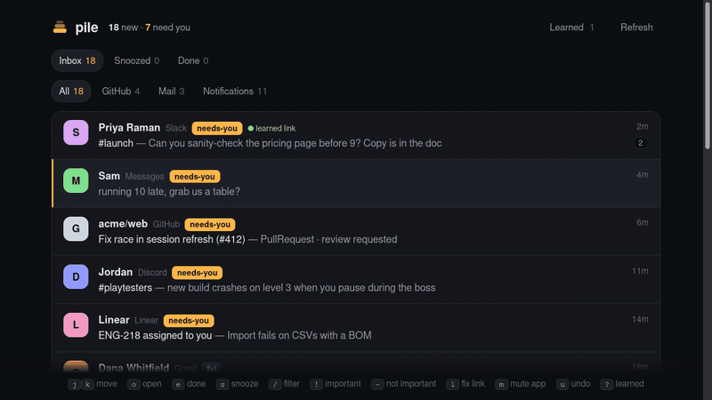
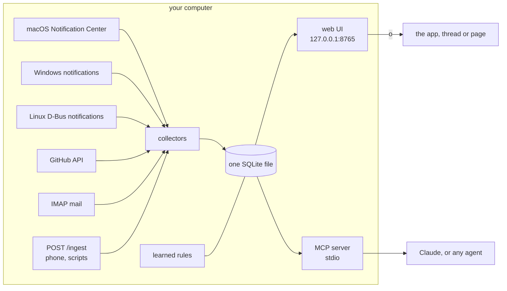
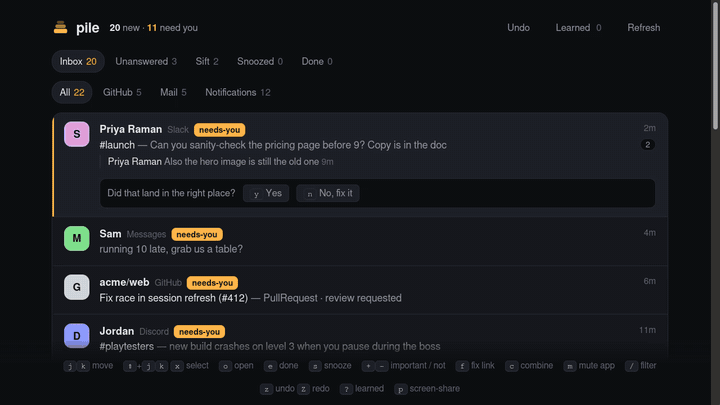

# pile

Take back your inbox.

You have accounts on a ton of platforms to keep up with. They want to keep you on them, so they make it hard to leave. But we can use their own greed against them: they all send push notifications and emails to pull you back in. pile catches those and builds one inbox from them, so you can skip their crappy UIs and actually get your job done.

[](LICENSE)
[-6fd49a)](pyproject.toml)
[](#platforms)



Every notification and unread lands in one local feed. Each item links back to the actual thread, PR or email. Any agent can work it over MCP. It runs on your machine, stores one SQLite file, and has no dependencies beyond Python 3.

## 60-second quickstart (Mac)

1. System Settings > Privacy & Security > **Full Disk Access**: add your terminal app (Terminal, iTerm, Ghostty...), then restart it. pile reads macOS's Notification Center database, read-only, and that file is behind this permission.
2. Run:

```sh
git clone https://github.com/conrs/pile && cd pile
python3 -m pile doctor                      # what works here, and how to turn on the rest
python3 -m pile collect && python3 -m pile serve
```

3. Open http://127.0.0.1:8765. `serve` keeps collecting every 30 seconds.

Just looking? `python3 -m pile serve --demo` runs on made-up data in a separate database.

[Setup video (75 s)](docs/setup.mp4)

## Keys

| | | | |
|---|---|---|---|
| `j` `k` move | `o` open the thread | `e` done | `s` snooze (hour, tonight, tomorrow, next week) |
| `/` filter | `!` always important from them | `-` not important | `l` fix where it opens |
| `m` mute this app | `u` undo | `?` what it's learned | `0`-`9` filter by source |

Items from the same person, channel or PR group into one row; `e` clears the whole row.

## Platforms

| Collector | Runs on | What it reads | Needs |
|---|---|---|---|
| `macos` | macOS | Notification Center database (every app and website that notifies you) | Full Disk Access for your terminal |
| `windows` | Windows | `%LOCALAPPDATA%\Microsoft\Windows\Notifications\wpndatabase.db` | nothing (it's your own file); install Python from python.org |
| `linux` | Linux | desktop notifications, live, via `dbus-monitor` | a desktop session; runs while `watch` or `serve` runs |
| `github` | any | GitHub notifications | `GITHUB_TOKEN`, or the `gh` CLI logged in |
| `imap` | any | unread mail (Gmail with an app password, or any IMAP server) | `PILE_IMAP_USER`, `PILE_IMAP_PASSWORD`, optional `PILE_IMAP_HOST` |
| `webhook` | any | anything you POST to `/ingest` | `pile token` |

`python3 -m pile doctor` tells you which of these work on your machine and what to do about the rest.

**Android.** No app needed yet. Either mirror your phone's notifications to your computer with [KDE Connect](https://kdeconnect.kde.org/) (Linux, Windows) or GSConnect (GNOME), and the desktop collector picks them up; or push them with Tasker, MacroDroid or ntfy to the webhook:

```sh
python3 -m pile serve --listen 0.0.0.0       # the UI stays local-only; /ingest needs the token
curl -X POST http://<your-computer>:8765/ingest \
  -H "Authorization: Bearer $(python3 -m pile token)" -H "Content-Type: application/json" \
  -d '{"app": "WhatsApp", "sender": "Sam", "body": "running late", "url": "whatsapp://"}'
```

A native Android companion app is future work.

## How it fits together



## Agents (MCP)

`python3 -m pile mcp` speaks MCP over stdio. Hand-rolled JSON-RPC, no SDK.

Claude Code:

```sh
claude mcp add pile -- python3 -m pile mcp
```

Claude Desktop (`claude_desktop_config.json`):

```json
{
  "mcpServers": {
    "pile": { "command": "python3", "args": ["-m", "pile", "mcp"], "cwd": "/path/to/pile" }
  }
}
```

Then ask "which three of these matter?" or "snooze everything from GitHub until tomorrow".

Tools: `list_inbox {source?, state?, label?, limit?}`, `get_item {id}`, `mark_done {ids}`, `snooze {ids, until}`, `open_item {id}`, and for teaching it: `fix_link {id, url}`, `set_rule {kind, match, value}`, `list_rules`, `delete_rule {id}`.

## It learns from you



- **Links.** After you open something, pile asks whether it landed in the right place. Say no and paste where you ended up. If that URL contains the item's sender, title or id (as-is, URL-encoded or slugified), pile turns those into placeholders and the fix covers the whole app: paste `https://acme.slack.com/archives/launch` for `#launch` and every Slack channel item opens its own channel. Otherwise it keeps the fix to that person or thread. Learned links win over the built-in table and show a "learned link" mark.
- **Importance.** `!` means always important from this sender, `-` means not important. These rules label new items before any model sees them, so they work with no model configured.
- **Mute.** `m` skips an app from now on and clears what's there.

Everything learned is in the Learned panel (`?`), where you can delete any of it. Agents can read and write the same rules over MCP.

## Optional: model triage

Off unless you configure it. Point it at any OpenAI-compatible endpoint (OpenRouter, Ollama, LM Studio...):

```sh
export PILE_BASE_URL=http://localhost:11434/v1 PILE_MODEL=llama3.1   # Ollama
# or PILE_BASE_URL=https://openrouter.ai/api/v1 PILE_MODEL=... PILE_API_KEY=...
python3 -m pile triage
```

It labels new items `needs-you`, `fyi` or `noise`; labels show as chips. Your own rules run first.

## Privacy

Everything stays on your machine: one SQLite file at `~/.local/share/pile/inbox.db` (or `--db PATH`). The web UI binds to 127.0.0.1 and refuses other host names and cross-site requests. Nothing leaves your computer unless you turn on model triage, which sends item text to the endpoint you chose. The collectors only read; pile never marks anything read in the source apps.

## Write a collector

A collector is one Python file. Drop it in `~/.config/pile/collectors/` (or `pile/collectors/` to send a PR) and `doctor` finds it:

```python
NAME = "rss"
PLATFORMS = ("any",)                    # or ("darwin",), ("linux", "windows")...
NEEDS = "PILE_RSS_URL"

def check(**opts):
    import os
    return (True, "ok") if os.environ.get("PILE_RSS_URL") else (False, "set PILE_RSS_URL")

def collect(store, **opts):
    n = 0
    for entry in fetch_entries():       # your code
        if store.upsert({
            "source": NAME, "ext_id": entry.id, "app": "rss", "app_name": "RSS",
            "thread": "rss|" + entry.feed, "sender": entry.feed, "title": entry.title,
            "body": entry.summary, "at": entry.timestamp, "url": entry.link,
        }):
            n += 1
    return n
```

Push-style sources (a socket, a D-Bus stream) define `listen(store, stop, **opts)` instead of `collect`. To teach pile a new app's deep link, add a line to `APPS` in `pile/deeplinks.py`.

## Tests

```sh
python3 -m unittest
```

No network: the tests build a fake Notification Center database (binary plists and all), a fake Windows notification database, captured `dbus-monitor` output and GitHub JSON.

`docs/media/record.sh` re-records the GIFs and the setup video on Linux (Xvfb, Firefox, xdotool, ffmpeg).

## License

MIT
