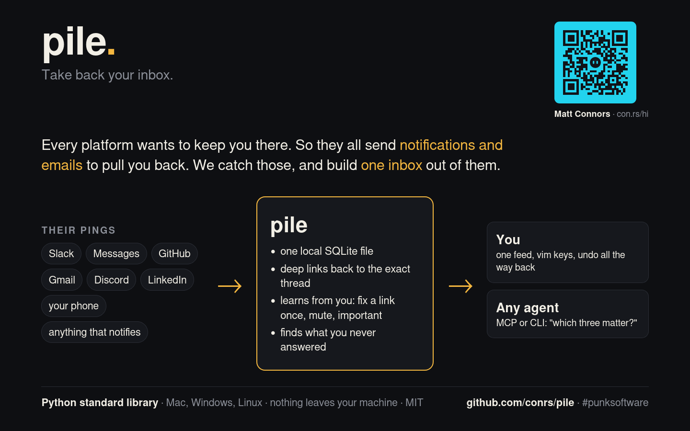
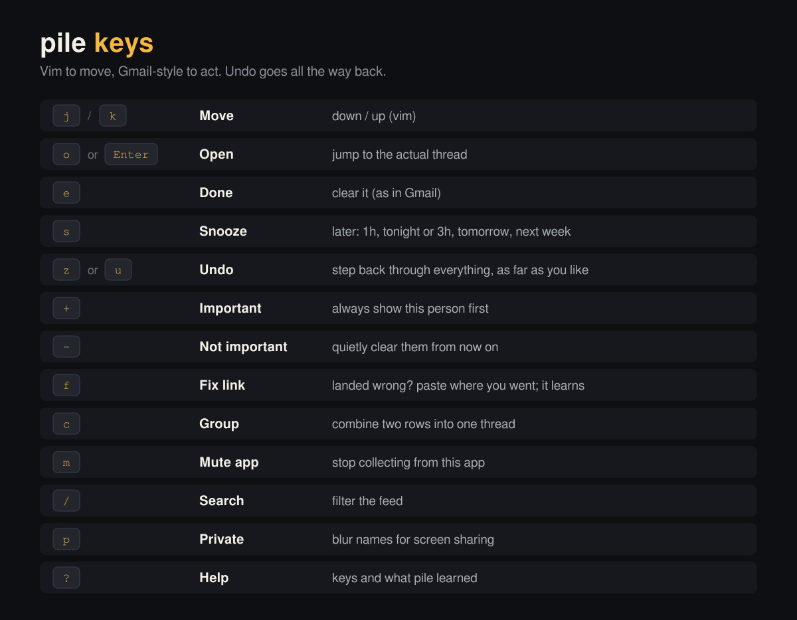
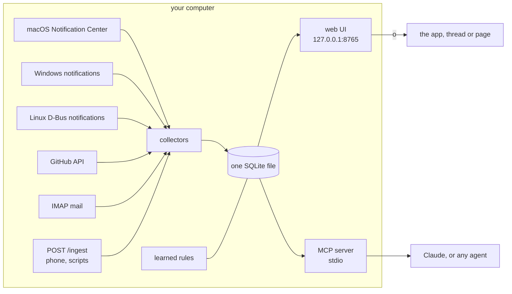

# pile

Take back your inbox.



You have accounts on a ton of platforms to keep up with. They want to keep you on them, so they make it hard to leave. But we can use their own greed against them: they all send push notifications and emails to pull you back in. pile catches those and builds one inbox from them, so you can skip their crappy UIs and actually get your job done.

[](LICENSE)
[-6fd49a)](pyproject.toml)
[](#platforms)


Every notification and unread lands in one local feed. Each item links back to the actual thread, PR or email. Any agent can work it over MCP. It runs on your machine, stores one SQLite file, and has no dependencies beyond Python 3.

## 60-second quickstart (Mac)

1. System Settings > Privacy & Security > **Full Disk Access**: add your terminal app (Terminal, iTerm, Ghostty...), then restart it. pile reads macOS's Notification Center database, read-only, and that file is behind this permission.
2. Run:

```sh
git clone https://github.com/conrs/pile && cd pile
python3 -m pile doctor                      # what works here, and how to turn on the rest
python3 -m pile collect && python3 -m pile serve
```

3. Open http://127.0.0.1:8765. `serve` keeps collecting every 30 seconds.

Just looking? `python3 -m pile serve --demo` runs on made-up data in a separate database.

macOS deletes notifications once you dismiss them, so pile can only see what's still in Notification Center (it keeps its own copy from then on). For the older stuff you never followed up on:

```sh
python3 -m pile backfill --days 30
```

That adds Messages conversations where they spoke last and you never replied, open GitHub review requests and assigned issues (plus older notifications), and mail from real people you never answered (lists and no-reply senders skipped). They get an "unanswered" chip and their own Unanswered tab, oldest first.

[Setup video (75 s)](docs/setup.mp4)

## Keys



| | | | |
|---|---|---|---|
| `j` `k` move | `o` / Enter open | `e` done | `s` snooze (hour, tonight, tomorrow, next week) |
| `+` always important | `-` not important | `f` fix where it opens | `c` combine rows into one conversation, `C` split |
| `x` select, `Shift`+`j`/`k` (or arrows, Home, End) extend, Esc clears | `m` mute this app | `/` filter | `z` undo (again and again), `Shift`+`Z` redo |
| `?` what it's learned | `p` screen-share mode | `0`-`9` filter by source | `r` collect now |

Selecting works like Gmail or vim's visual mode: the first `Shift`+`j`/`k` (or Shift+arrow, Shift-click) drops an anchor, and the selection runs from the anchor to the cursor, so moving back shrinks it. `x` and Cmd/Ctrl-click add or remove single rows. With rows selected, `e`, `s`, `+`, `-`, `m` and `c` act on all of them at once, as one step that one `z` undoes. Undo is a stack kept in the database, so it goes all the way back, even after a restart. Every action also has a button on the row, so a mouse or a touchscreen works too.

Items from the same conversation group into one row (pile uses the thread id apps attach to their notifications, so a group text is one row); select it to see the earlier messages, and `e` clears the whole row. If several rows are really one conversation, select them and press `c`: they fold into the newest one, and pile remembers it.

**Screen-share mode** (`p`, or open `/?private`) blurs every name, message and avatar so you can demo or stream your real inbox. `/?private&keep=github` leaves repo names readable.

**Follow mode:** drive pile in your own window and share a second one opened at `http://127.0.0.1:8765/?private&follow`. It mirrors your cursor, selection, menus, toasts and scroll live, blurred, and ignores input (Esc detaches it).

**History:** `pile history` lists what you did (open, done, snooze, labels, link fixes), newest first, `--json` for scripts. `pile reopen --since 2h` (or `--all`, `--source github`) puts cleared items back. `pile list --state done` shows what you cleared. `pile undo` and `pile redo` work from the terminal too.

**Opening Messages:** a Messages notification only names the sender, so pile looks the message up in `chat.db` (by its text and time) to open that exact conversation, and keeps the link. `pile open-test <id>` shows which link it would use and why.

## Platforms

| Collector | Runs on | What it reads | Needs |
|---|---|---|---|
| `macos` | macOS | Notification Center database (every app and website that notifies you) | Full Disk Access for your terminal |
| `messages` | macOS | `chat.db`: conversations waiting on your reply (`pile backfill`) | Full Disk Access for your terminal |
| `windows` | Windows | `%LOCALAPPDATA%\Microsoft\Windows\Notifications\wpndatabase.db` | nothing (it's your own file); install Python from python.org |
| `linux` | Linux | desktop notifications, live, via `dbus-monitor` | a desktop session; runs while `watch` or `serve` runs |
| `github` | any | GitHub notifications | `GITHUB_TOKEN`, or the `gh` CLI logged in |
| `imap` | any | unread mail from one or more accounts (Gmail with an app password, or any IMAP server) | `PILE_IMAP_USER`, `PILE_IMAP_PASSWORD` (see [Mail](#mail)) |
| `mailapp` | macOS | Apple Mail's local index: every account Mail.app has, no passwords | Full Disk Access; Mail.app set up |
| `webhook` | any | anything you POST to `/ingest` | `pile token` |

`python3 -m pile doctor` tells you which of these work on your machine and what to do about the rest.

**Android.** No app needed yet. Either mirror your phone's notifications to your computer with [KDE Connect](https://kdeconnect.kde.org/) (Linux, Windows) or GSConnect (GNOME), and the desktop collector picks them up; or push them with Tasker, MacroDroid or ntfy to the webhook:

```sh
python3 -m pile serve --listen 0.0.0.0       # the UI stays local-only; /ingest needs the token
curl -X POST http://<your-computer>:8765/ingest \
  -H "Authorization: Bearer $(python3 -m pile token)" -H "Content-Type: application/json" \
  -d '{"app": "WhatsApp", "sender": "Sam", "body": "running late", "url": "whatsapp://"}'
```

A native Android companion app is future work.

## Mail

Put settings in `~/.config/pile/env` (then `chmod 600 ~/.config/pile/env`). pile reads it, then a `.env` in the folder you run it from; real environment variables always win, and `pile doctor` says which file it used without printing values. Prefer the config file over a `.env` inside a repo.

```sh
# Gmail: turn on 2-Step Verification, then make an app password at myaccount.google.com/apppasswords
PILE_IMAP_USER=you@gmail.com
PILE_IMAP_PASSWORD="abcd efgh ijkl mnop"
PILE_IMAP_NAME=personal
# more accounts: the same with a number
PILE_IMAP_2_USER=you@work.example.com
PILE_IMAP_2_PASSWORD=...
PILE_IMAP_2_HOST=imap.work.example.com
PILE_IMAP_2_NAME=work
```

Each account gets its own source filter and label, and Gmail links open the exact thread in the right signed-in account. Outlook.com and Microsoft 365 need OAuth rather than app passwords, so they don't work over IMAP yet; Gmail API, JMAP and Microsoft Graph collectors are future work. On a Mac, the `mailapp` collector reads Apple Mail's own index instead, with no passwords at all.

**Tasks.** Without any model, pile marks an email as a `task` when a real person (not a list, a receipt or a no-reply robot) wrote to you directly (you're in To, not just Cc), you haven't replied, and it asks for something: a question, "can you", "please", "by Friday", "review", "sign", a deadline. Your `+` and `-` rules and optional model triage still apply.

**Sift.** Unread newsletters, receipts and updates stay out of the inbox. Once you reach inbox zero, a Sift button shows them oldest first, grouped by sender, so `e` clears a sender's pile and `-` teaches pile they don't matter.

## How it fits together



## Agents (MCP)

`python3 -m pile mcp` speaks MCP over stdio. Hand-rolled JSON-RPC, no SDK.

Claude Code:

```sh
claude mcp add pile -- python3 -m pile mcp
# or, so the agent sees pseudonyms instead of names and no secrets:
claude mcp add pile -- python3 -m pile mcp --redact
```

Claude Desktop (`claude_desktop_config.json`):

```json
{
  "mcpServers": {
    "pile": { "command": "python3", "args": ["-m", "pile", "mcp"], "cwd": "/path/to/pile" }
  }
}
```

Then ask "which three of these matter?" or "snooze everything from GitHub until tomorrow".

Tools: `list_inbox {source?, state?, label?, tag?, limit?}`, `history {limit?}`, `undo {steps?}`, `redo {steps?}`, `get_item {id}`, `mark_done {ids}`, `snooze {ids, until}`, `open_item {id}`, and for teaching it: `fix_link {id, url}`, `set_rule {kind, match, value}`, `list_rules`, `delete_rule {id}`.

## It learns from you


- **Links.** After you open something, pile asks whether it landed in the right place. Say no and paste where you ended up. If that URL contains the item's sender, title or id (as-is, URL-encoded or slugified), pile turns those into placeholders and the fix covers the whole app: paste `https://acme.slack.com/archives/launch` for `#launch` and every Slack channel item opens its own channel. Otherwise it keeps the fix to that person or thread. Learned links win over the built-in table and show a "learned link" mark.
- **Importance.** `+` means always important from this sender, `-` means not important. These rules label new items before any model sees them, so they work with no model configured.
- **Mute.** `m` skips an app from now on and clears what's there.

Everything learned is in the Learned panel (`?`), where you can delete any of it. Agents can read and write the same rules over MCP.

## Redaction: what agents see

Your inbox is full of other people's names, phone numbers and one-time codes. Run the MCP server with `--redact` (or set `PILE_REDACT=1`) and agents get the context without those:

- **Secrets are dropped:** one-time and verification codes, API keys and tokens (`sk-`, `ghp_`, `xoxb-`, `AKIA`, JWTs, long random strings), `password: ...`, card numbers (Luhn-checked) and IBANs become `[code]`, `[secret]`, `[card]`, `[iban]`.
- **People become stable pseudonyms:** names, emails and phone numbers turn into `Person-7f3a`, `Email-…`, `Phone-…`, a keyed hash with a local key (`redact.key` next to the database, mode 600). The same person is the same pseudonym everywhere, so an agent can say "Person-7f3a asked twice", and pile maps it back when the agent acts on it. Street addresses become `[address]`.
- **Context stays:** apps, public repo names, times and ordinary numbers ("3 PRs", "#412") are untouched. Add your own name and anything else to keep with `PILE_REDACT_ALLOW=Matt,acme`.
- **Actions still work:** tools take item ids and the pseudonyms the agent was shown.

`pile doctor` suggests it when your triage model isn't local, and the UI header shows "agents: redacted" when the server runs with it. `pile export --redacted [--json]` gives the same view for a bug report or demo data, and `/?private=names` shows pseudonyms on screen instead of blur. An optional model pass (`PILE_REDACT_MODEL=1`) rewrites message bodies into neutral one-liners using your triage endpoint, after the deterministic pass and checked again by it.

The approach (drop secrets, drop PII, keep context, rewrite, and content-hash things so they can still be referred to) comes from [Viva la Trace](https://github.com/MT-GoCode/viva-la-trace).

## Optional: model triage

Off unless you configure it. Point it at any OpenAI-compatible endpoint (OpenRouter, Ollama, LM Studio...):

```sh
export PILE_BASE_URL=http://localhost:11434/v1 PILE_MODEL=llama3.1   # Ollama
# or PILE_BASE_URL=https://openrouter.ai/api/v1 PILE_MODEL=... PILE_API_KEY=...
python3 -m pile triage
```

It labels new items `needs-you`, `fyi` or `noise`; labels show as chips. Your own rules run first.

## Writeback: done means done everywhere

Set `PILE_WRITEBACK=1` and marking something done in pile clears it at the source too: mail is marked read over IMAP, and GitHub notification threads are marked done. It happens in the background, so pile stays instant. Undo puts mail back to unread; GitHub can't make a thread unread again, so an undone GitHub item just stays in pile. Snooze stays inside pile. Notification Center banners can't be cleared by another app on macOS, so those only leave pile.

## Privacy

Everything stays on your machine: one SQLite file at `~/.local/share/pile/inbox.db` (or `--db PATH`). The web UI binds to 127.0.0.1 and refuses other host names and cross-site requests. Nothing leaves your computer unless you turn on model triage, which sends item text to the endpoint you chose. The collectors only read, and pile never changes anything in the source apps unless you turn on writeback (below).

## Write a collector

A collector is one Python file. Drop it in `~/.config/pile/collectors/` (or `pile/collectors/` to send a PR) and `doctor` finds it:

```python
NAME = "rss"
PLATFORMS = ("any",)                    # or ("darwin",), ("linux", "windows")...
NEEDS = "PILE_RSS_URL"

def check(**opts):
    import os
    return (True, "ok") if os.environ.get("PILE_RSS_URL") else (False, "set PILE_RSS_URL")

def collect(store, **opts):
    n = 0
    for entry in fetch_entries():       # your code
        if store.upsert({
            "source": NAME, "ext_id": entry.id, "app": "rss", "app_name": "RSS",
            "thread": "rss|" + entry.feed, "sender": entry.feed, "title": entry.title,
            "body": entry.summary, "at": entry.timestamp, "url": entry.link,
        }):
            n += 1
    return n
```

Push-style sources (a socket, a D-Bus stream) define `listen(store, stop, **opts)` instead of `collect`. Sources with history can also define `backfill(store, days, **opts)` for `pile backfill`. To teach pile a new app's deep link, add a line to `APPS` in `pile/deeplinks.py`.

## Tests

```sh
python3 -m unittest
```

No network: the tests build a fake Notification Center database (binary plists and all), a fake Windows notification database, captured `dbus-monitor` output and GitHub JSON.

`docs/media/record.sh` re-records the GIFs and the setup video on Linux (Xvfb, Firefox, xdotool, ffmpeg).

## License

MIT
